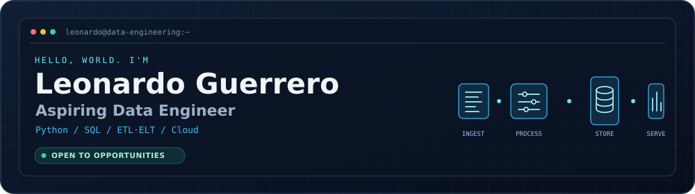
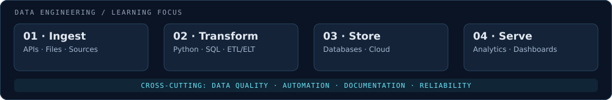
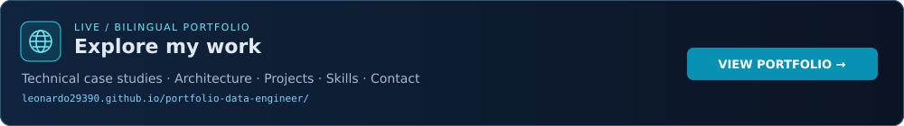

<!-- Leonardo Guerrero Guatame | GitHub profile -->

  
  
   
  
  
  
   
  
  

01 / About me
I'm a Software Engineering student at Universidad Manuela Beltrán, building my career in Data Engineering. I am interested in designing reliable systems that collect, transform, store and deliver useful data.
- Focus: Python, SQL, relational data modeling, ETL/ELT and cloud computing.
- Currently: developing my academic cloud accounting and digital twin project, while strengthening my data engineering skills.
- Learning: data orchestration, distributed processing and data quality practices.
- Open to: junior, trainee and internship opportunities in data engineering, as well as technical collaboration.

<b>Sobre mí · Español</b>

 
Soy estudiante de Ingeniería de Software en la Universidad Manuela Beltrán, orientado a Ingeniería de Datos. Me interesa integrar fuentes, diseñar modelos de datos y procesos ETL/ELT, y construir soluciones confiables en la nube. Estoy abierto a prácticas profesionales y oportunidades Junior o Trainee.

02 / Engineering focus

  

Data integration
APIs, data sources, extraction and loading
Data modeling
SQL, relational databases and transactional schemas
Processing
Python, Pandas, cleaning and transformation
Cloud
Google Cloud, Cloud Run and containerized applications
Analytics
Power BI, dashboards and reporting
03 / Tech stack
Languages
 
Databases
 
Cloud & DevOps
Software development
Data & analytics
 

Currently exploring:

   
04 / Featured projects
Cloud Accounting & Digital Twin
Academic degree project exploring cloud accounting data integration and digital representations of accounting processes.
Google Cloud · In development
ERP FullBike
Enterprise application for motorcycle parts, customers and sales management.
C# · ASP.NET MVC · Entity Framework
DomiFlow
Academic delivery platform with transactional order workflows and role-based interfaces.
Java · Spring Boot · PostgreSQL · Supabase · React
Personal Finance Manager
Group project for financial transactions, analytics dashboards and data exports.
Python · Flask · SQLAlchemy · Pandas · React · Docker
Data Engineering Portfolio
Bilingual portfolio featuring technical skills, academic case studies and contact information. Live website.
React · TypeScript · Tailwind CSS · GitHub Pages

  

05 / GitHub activity

  
  
   
  

<!-- Optional contribution snake: enable after the workflow has published the output branch.
## 06 / Contribution snake

<picture>
  <source media="(prefers-color-scheme: dark)" srcset="https://raw.githubusercontent.com/Leonardo29390/Leonardo29390/output/github-snake-dark.svg" />
  
</picture>
-->

  
  <a href="https://leonardo29390.github.io/portfolio-data-engineer/">Portfolio</a> · <a href="https://www.linkedin.com/in/leonardo-guerrero-guatame-125b38367/">LinkedIn</a> · <a href="mailto:guerreroguatameleonardo@gmail.com">Contact</a>

